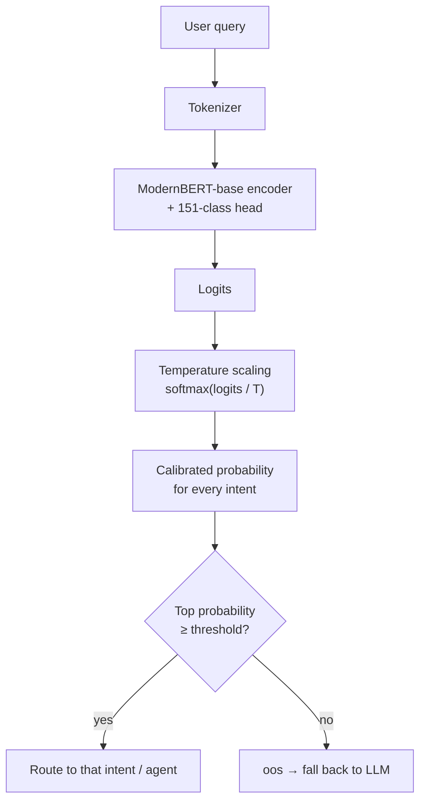

# CalibRoute: Calibrated Intent Router for Multi-Agent Systems

CalibRoute is a small, fast model that reads a user's message and decides which agent should handle it. What makes it different from a normal classifier is that it also knows when it isn't sure. When a message doesn't fit any known intent, it says so instead of guessing, so the message can be passed to an LLM.

## Why I built this

If you build a system with several AI agents (one for answering questions, one for bookings, one for support), something has to decide which agent gets each message. There are usually two ways to do it, and both have problems.

| Approach | Problem |
|---|---|
| Ask an LLM to pick the agent | Works well, but it's slow and costs money on every message |
| Train a normal classifier | Fast and cheap, but it always picks an answer, even for messages it has never seen before |

I wanted the speed of a classifier without the blind guessing. So this project focuses on three things:

1. **Honest confidence.** If the model says it's 90% sure, it should be right about 90% of the time.
2. **Saying "I don't know".** Messages that don't match any intent get labeled as out of scope.
3. **Handling messy input.** Real users make typos and send one-word messages, so the model has to cope with both.

The idea came from decision models like TypeSafe's Jev, which give a probability for every possible option instead of writing text.

## Results

I tested everything on the official CLINC150 test set, which has 5,500 real queries across 150 intents plus an "out of scope" category.

I trained two models so I could compare them fairly:

* **Model A** is the baseline, trained on the original data only.
* **Model B** is the final model, trained with extra examples containing typos and short queries.

Both went through exactly the same calibration steps, and all settings were chosen on the validation set, never on the test set.

### Normal test queries

| Metric | Model A | Model B |
|---|---|---|
| Overall accuracy | 92.16% | **92.18%** |
| In-scope accuracy | 92.16% | 91.98% |
| Out-of-scope recall | 92.20% | **93.10%** |
| Out-of-scope precision | 75.57% | 74.30% |
| Calibration error (ECE) | 0.0216 | **0.0212** |

### The same queries with typos added

| Metric | Model A | Model B | Change |
|---|---|---|---|
| Overall accuracy | 70.04% | **80.13%** | **+10.1** |
| In-scope accuracy | 64.62% | **77.07%** | **+12.5** |
| Out-of-scope precision | 39.28% | **49.66%** | +10.4 |
| Calibration error (ECE) | 0.0518 | **0.0284** | **45% lower** |

### My own stress test

I also wrote 38 new queries by hand that neither model had ever seen, grouped by difficulty.

| Category | Model A | Model B |
|---|---|---|
| Normal questions, reworded | 10/12 | **11/12** |
| Typos | 5/10 | **7/10** |
| Very short queries | 6/8 | **8/8** |
| Out of scope | 8/8 | 8/8 |
| **Total** | **76.3%** | **89.5%** |

In short, the extra training data made the model 10 points better on messy input and 45% better calibrated, without making it any worse on clean input.

## How it works

A message goes through five steps:

1. The text is split into tokens.
2. ModernBERT reads the tokens and produces a raw score for each of the 151 possible labels.
3. The scores are divided by a "temperature" value and turned into probabilities. This step is what makes the confidence honest.
4. The label with the highest probability is picked.
5. If that probability is below a set threshold, the message is marked as out of scope and sent to the LLM instead.

### The model

I used ModernBERT-base, which has about 150 million parameters, with a classification layer for 151 labels on top. Training took 5 epochs with a learning rate of 5e-5 and a batch size of 64. It ran in 3 to 5 minutes on a free Kaggle T4 GPU, and I kept whichever epoch had the lowest validation loss.

### Making the confidence honest

Neural networks tend to be overconfident. To fix this, I used temperature scaling. After training, I learned a single number (the temperature) on the validation set and divided all of the model's scores by it. This doesn't change which answer the model picks, only how sure it claims to be. I checked the result with Expected Calibration Error, the Brier score, and reliability diagrams.

### Detecting out-of-scope messages

The model has two ways to say "this doesn't belong here":

1. **A dedicated "out of scope" label**, learned from real off-topic examples in the dataset.
2. **A confidence threshold.** If the model isn't confident enough about any label, the message is treated as out of scope.

I picked the threshold on the validation set by balancing in-scope accuracy against out-of-scope recall. The threshold matters a lot. In an early run, adding it raised out-of-scope recall from 63% to almost 89%, while in-scope accuracy dropped by only 1.6 points. Models are bad at admitting they don't know unless you give them a way to.

### Fixing the weak spots

When I looked at the baseline model's mistakes, two problems stood out. It struggled with typos, and it misread very short messages. For example, it labeled "fees?" as a greeting. I added two kinds of extra training data to fix this.

| Extra data | How it was made | Example |
|---|---|---|
| Typo copies | 30% of the training sentences got a copy with one or two realistic typos: swapped letters, missing letters, doubled letters, or a neighbouring key on the keyboard | "what is my account balance" became "what is my acount balance" |
| Short versions | For each intent, one to three word versions built from the intent name and its most typical words. Any short version that could belong to two intents was removed | "balance?", "lost card", "credit score" |

To measure the effect fairly, I made a separate copy of the test set with typos added. The original test set was never changed.

## What I learned

**Look at the model's most confident mistakes.** This was the most useful thing I did. Several of the "mistakes" turned out to be wrong labels in the dataset itself. For example, "can i get a table for four at 8:00" is labeled as asking how busy a restaurant is, but the model's answer (a restaurant reservation) is clearly right. So the model is actually a bit better than its score suggests.

**Messages that are almost in scope are the hardest.** A request like "can you order some ointment for me" looks very close to a real intent but counts as out of scope in this dataset, and the model was confidently wrong about it.

**Template data teaches shortcuts.** My first prototype was trained on sentences generated from templates. It scored 100% on its own test set, but it had learned lazy rules, like "is there" always means a booking and "pay" always means a support issue. As soon as real people's phrasing was involved, it fell apart. Switching to real human queries from CLINC150 fixed this.

**Every fix has a side effect.** The short-query training worked, but it also made the model too confident on vague one-word messages. That's why I always test again after changing anything.

## Project structure

* **01_synthetic_router:** the first prototype, a 4-agent router trained on template data and exported to ONNX
* **02_clinc150_router:** baseline training on CLINC150, calibration, and the out-of-scope threshold
* **03_augmentation:** the typo and short-query training data, and the Model A vs Model B comparison
* **assets:** reliability diagrams and threshold charts

## Running it yourself

Everything runs on a free Kaggle notebook. Create a new notebook, turn on the T4 GPU and internet access in the settings, install the libraries listed in the first cell, and run the cells in order. The whole thing takes about 10 minutes.

## Example predictions

| Message | What the final model says |
|---|---|
| whats my acount balance | balance (99% sure) |
| trnasfer money to my savings | transfer (94% sure) |
| credit scor | credit score (99% sure) |
| lost card | report lost card (92% sure) |
| how do i learn python | out of scope |
| tell me about admission fees | out of scope |

## Tools used

| Area | Tools |
|---|---|
| Deep learning | PyTorch, Hugging Face Transformers, Accelerate |
| Model | ModernBERT-base from Answer.AI |
| Data | Hugging Face Datasets, CLINC150, pandas |
| Evaluation | NumPy, SciPy, scikit-learn, Matplotlib |
| Deployment (prototype) | ONNX, ONNX Runtime |
| Hardware | Kaggle T4 GPU with mixed precision training |

## Limitations

* **English only.** I haven't tested it on Urdu or Roman Urdu. That would need a multilingual model such as XLM-R.
* **Limited topics.** The 150 intents cover banking, travel, work, and small talk. A different domain needs its own labeled data.
* **Too confident on vague one-word messages.** On inputs like "card" or "fees?" the final model is more confident than it should be. Its average confidence on a set of vague messages was 0.67, compared with 0.44 for the baseline.
* **Heavy typos still hurt.** Accuracy drops from 92% on clean text to 80% with typos.

## What's next

* [ ] Knowledge distillation: train a larger ModernBERT as a teacher and have the smaller model learn from its probabilities, to reduce overconfidence on vague messages
* [ ] A second round of typo training with more copies and more typos per sentence
* [ ] Reinforcement learning for calibration, rewarding the model for honest confidence and not just correct answers
* [ ] An ONNX version of the CLINC150 model and a small API around it
* [ ] Automatically finding wrong labels in the dataset

## Credits

* The CLINC150 dataset comes from Larson et al., "An Evaluation Dataset for Intent Classification and Out-of-Scope Prediction", EMNLP 2019.
* ModernBERT was developed by Answer.AI and LightOn.
* The idea was inspired by calibrated decision models such as TypeSafe's Jev.

## Author

**Nasir Sultan**, AI Engineer and Backend Lead based in Lahore, Pakistan

* GitHub: [NasirSultan](https://github.com/NasirSultan)
* Portfolio: [nasir.shoutlyai.com](https://nasir.shoutlyai.com)

## License

Add a license of your choice (for example MIT) before publishing.
